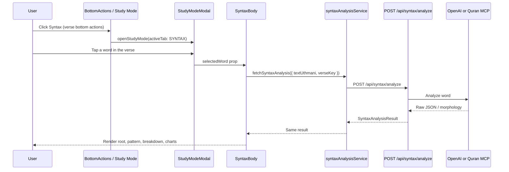

# Syntax feature — end-to-end request flow

This guide walks a **new developer** through what happens from the moment a user opens Syntax on a verse, through selecting a word, calling the API, processing the response, and rendering the UI.

**Related docs:** [syntax-study-mode-design.md](./syntax-study-mode-design.md) · [syntax-content-api-usage.md](./syntax-content-api-usage.md)

---

## Big picture (one sentence)

User opens **Study Mode → Syntax**, taps a **word**, the browser POSTs that word to **`/api/syntax/analyze`**, the server asks **OpenAI** (or **Quran MCP**), returns a normalized JSON object, and **SyntaxBody** renders morphology + optional charts.



---

## Step 1 — User opens Syntax for a verse

### From the main reading / translation page

1. Under a verse, the user taps the **Syntax** tab next to Tafsir.
2. That dispatches Redux `openStudyMode` with `activeTab: StudyModeTabId.SYNTAX`.

| Step | What happens | File |
|------|----------------|------|
| Tab list (Tafsir, Syntax, …) | Builds bottom-action tabs | `src/components/QuranReader/TranslationView/BottomActions.tsx` |
| Renders clickable tabs | Scrollable tab UI | `src/components/QuranReader/TranslationView/BottomActionsTabs.tsx` |
| Opens Study Mode | `dispatch(openStudyMode({ verseKey, activeTab: SYNTAX }))` | `BottomActions.tsx` → `src/redux/slices/QuranReader/studyMode.ts` |
| Tab id enum | `TabId.SYNTAX` / `StudyModeTabId.SYNTAX` | `BottomActionsTabs.tsx`, `StudyModeBottomActions/index.tsx` |

Used from:

- Translation view: `TranslationViewCell.tsx`
- Reading view word modal: `ReadingView/WordMobileModal/index.tsx`

### Already inside Study Mode

User can also switch to the Syntax tab using the Study Mode bottom bar.

| Step | File |
|------|------|
| Tab config (label `Syntax`, search icon) | `StudyModeModal/StudyModeBodyTabs.tsx` |
| Tab bar UI | `StudyModeModal/StudyModeBottomActions/index.tsx` |
| Which panel to show | `StudyModeModal/StudyModeBody.tsx` (`TAB_COMPONENTS[SYNTAX]`) |

---

## Step 2 — Study Mode loads the verse (words available to click)

Before Syntax can analyze a word, Study Mode needs the verse’s **word list** (Uthmani text, location, translation, etc.).

| Step | What happens | File |
|------|----------------|------|
| Modal shell / state | Opens from Redux; tracks chapter, verse, selected word | `StudyModeModal/index.tsx` |
| Fetch verse + words | SWR + `makeByVerseKeyUrl` → Content API `GET /api/qdc/verses/by_key/{verseKey}` | `StudyModeModal/index.tsx`, `src/utils/apiPaths.ts`, `src/utils/api.ts` |
| Filter real words | `charTypeName === Word` | `StudyModeModal/index.tsx` |

This Content API call is **not** the Syntax analysis request. It only supplies the verse/words UI. Details: [syntax-content-api-usage.md](./syntax-content-api-usage.md).

---

## Step 3 — User clicks a word

| Step | What happens | File |
|------|----------------|------|
| Word click | `handleWordClick` → `setSelectedWordLocation(word.location)` | `StudyModeModal/index.tsx` |
| Resolve `Word` object | Find word in `quranWords` by `location` | `StudyModeModal/index.tsx` |
| Pass into body | `selectedWord={selectedWord}` | `StudyModeBody.tsx` → `StudyModeSyntaxTab.tsx` → `SyntaxBody.tsx` |

Important fields on `Word` (from Content API):

- `textUthmani` / `qpcUthmaniHafs` / `text` — Arabic surface form  
- `verseKey` — e.g. `"2:255"`  
- `location` — unique word location string  
- `translation`, `transliteration` — shown in the Syntax header  

---

## Step 4 — Syntax tab mounts and builds the request

| Step | What happens | File |
|------|----------------|------|
| Lazy-load tab shell | Dynamic import + skeleton | `StudyModeSyntaxTab.tsx`, `SyntaxSkeleton.tsx` |
| Syntax UI + fetch | `SyntaxBody` | `SyntaxView/SyntaxBody.tsx` |
| Extract Arabic text | `getWordTextUthmaniForSyntax(selectedWord)` | `src/services/syntaxAnalysisService.ts` |
| SWR cache key | `['syntax-analysis', location, wordText, verseKey]` | `SyntaxBody.tsx` |
| Trigger fetch | When key is non-null, SWR calls `fetchSyntaxAnalysis` | `SyntaxBody.tsx` + `swr` |

If no word is selected, **no request** is made (`swrKey` is `null`). The UI shows: “Select a word in the verse to analyze.”

---

## Step 5 — Client HTTP request (URL + payload)

**File:** `src/services/syntaxAnalysisService.ts`

### Mock mode (optional)

If `NEXT_PUBLIC_SYNTAX_ANALYSIS_MOCK=true`:

- **No network call**
- Returns clone of `src/services/syntaxAnalysis.mock.ts`

### Real mode

| Item | Value |
|------|--------|
| **Method** | `POST` |
| **URL** | `/api/syntax/analyze` (same origin as the Next.js app, e.g. `http://localhost:3000/api/syntax/analyze`) |
| **Headers** | `Content-Type: application/json` |
| **Body (payload)** | See below |

**Request payload example:**

```json
{
  "textUthmani": "ٱللَّهِ",
  "verseKey": "1:1"
}
```

| Field | Required | Meaning |
|-------|----------|---------|
| `textUthmani` | Yes | Arabic word string from the selected token |
| `verseKey` | No | Verse context (e.g. `1:1`) for the model / MCP |

On non-OK responses or `{ error: "..." }` body, the client **throws** `Error` with that message; SWR surfaces it in `SyntaxBody`.

---

## Step 6 — Server API route processes the request

**File:** `src/pages/api/syntax/analyze.ts`

1. Reject non-`POST` → `405`
2. Read `textUthmani`, `verseKey` from `req.body`
3. Validate: non-empty text, max length **200** → else `400`
4. Choose provider from env:

| Env | Effect |
|-----|--------|
| `SYNTAX_ANALYSIS_PROVIDER=openai` | Use ChatGPT / OpenAI (current local default) |
| `SYNTAX_ANALYSIS_PROVIDER=quran_mcp` | Use Quran MCP |
| Unset | OpenAI if `OPENAI_API_KEY` is set, else MCP |

---

## Step 7a — OpenAI provider (ChatGPT path)

**Still in:** `src/pages/api/syntax/analyze.ts`

| Step | Detail |
|------|--------|
| Auth | `OPENAI_API_KEY` required; missing → `503` |
| Model | `SYNTAX_ANALYSIS_MODEL` or `OPENAI_SYNTAX_MODEL` or `gpt-4o-mini` |
| Upstream URL | `https://api.openai.com/v1/chat/completions` |
| Upstream body | `messages`: system prompt (JSON schema for morphology + charts) + user prompt with verse + word |
| Parse | Read `choices[0].message.content`, strip markdown fences if needed (`extractJsonFromContent`) |
| Normalize | `normalizeResult(parsed)` → validates required fields, attaches optional charts |
| Response | `200` + `SyntaxAnalysisResult` JSON |

**User prompt shape (sent to OpenAI):**

```text
Verse context: 1:1
Arabic word (Uthmani): ٱللَّهِ

Analyze this single word and fill the JSON.
```

---

## Step 7b — Quran MCP provider (alternate path)

When `SYNTAX_ANALYSIS_PROVIDER=quran_mcp`:

| Step | File |
|------|------|
| Connect Streamable HTTP MCP | `src/lib/syntaxAnalysisQuranMcp.ts` |
| Tools: grounding → morphology → paradigm | `src/lib/syntaxAnalysisQuranMcpMorphology.ts` |
| Optional charts from paradigm | `src/lib/syntaxChartsFromMcp.ts` + `src/lib/syntaxAnalysisCharts.ts` |
| Return | Same `SyntaxAnalysisResult` shape |

MCP URL: `QURAN_SYNTAX_MCP_URL` or default `https://mcp.quran.ai/`.

---

## Step 8 — Response shape (`SyntaxAnalysisResult`)

**Type definition:** `types/SyntaxAnalysis.ts`

**Success (200) — required fields:**

```json
{
  "rootLetter": { "arabicName": "...", "rootLetter": "..." },
  "pattern": { "wordPattern": "...", "patternType": "..." },
  "wordBreakDown": [{ "part": "...", "meaning": "..." }]
}
```

**Optional charts** (when present and valid):

- `sarfChart`
- `verbPresentTenseChart` / `verbPastTenseChart` / `verbChart`
- `ismChart`

**Error examples:**

| Status | Body | When |
|--------|------|------|
| `400` | `{ "error": "..." }` | Bad / empty / too-long word |
| `502` | `{ "error": "..." }` | OpenAI/MCP failure or bad JSON |
| `503` | `{ "error": "..." }` | OpenAI selected but no API key |

---

## Step 9 — Client receives and processes the response

| Step | What happens | File |
|------|----------------|------|
| Parse JSON | `res.json()` | `syntaxAnalysisService.ts` |
| Error check | If `!res.ok` or `error` key → throw | `syntaxAnalysisService.ts` |
| SWR stores data | `analysis` in `SyntaxBody` | `SyntaxBody.tsx` |
| Loading UI | `isValidating && !analysis` → “Loading analysis…” | `SyntaxBody.tsx` |
| Error UI | Shows thrown message | `SyntaxBody.tsx` |

No extra client-side reshape beyond what the API already normalized. The UI trusts `SyntaxAnalysisResult`.

---

## Step 10 — Render on screen

**File:** `src/components/QuranReader/SyntaxView/SyntaxBody.tsx`

| UI block | Data used | Supporting files |
|----------|-----------|------------------|
| Title “Grammatical Analysis of the word: …” | `wordText` + Arabic typography | `useSyntaxChartArabicTypography.ts`, `SyntaxView.module.scss` |
| Translation / transliteration line | `selectedWord.translation` / `.transliteration` | `SyntaxBody.tsx` |
| Root letters | `analysis.rootLetter.rootLetter` | `SyntaxBody.tsx` |
| Pattern | `analysis.pattern.wordPattern` + `patternType` | `SyntaxBody.tsx` |
| Word breakdown list | `analysis.wordBreakDown[]` | `SyntaxBody.tsx` |
| Charts (sarf / verb / ism) | Optional chart fields | `SyntaxChartTables.tsx` |
| Layout wrapper | Scroll container, font scale | `SyntaxTabLayout.tsx`, `StudyModeSyntaxTab.tsx` |

Font scale follows Quran Reader tafsir scale: `selectQuranReaderStyles` in Redux (`src/redux/slices/QuranReader/styles`).

---

## File checklist (by responsibility)

| Responsibility | Path |
|----------------|------|
| Open Syntax from verse actions | `TranslationView/BottomActions.tsx` |
| Study Mode open state | `redux/slices/QuranReader/studyMode.ts` |
| Modal, word selection, verse fetch | `ReadingView/StudyModeModal/index.tsx` |
| Tab bar + Syntax tab config | `StudyModeBodyTabs.tsx`, `StudyModeBottomActions/index.tsx` |
| Panel wiring | `StudyModeBody.tsx` |
| Syntax tab shell | `tabs/StudyModeSyntaxTab.tsx` |
| Fetch + render morphology | `SyntaxView/SyntaxBody.tsx` |
| Chart tables | `SyntaxView/SyntaxChartTables.tsx` |
| Client API helper | `services/syntaxAnalysisService.ts` |
| Mock response | `services/syntaxAnalysis.mock.ts` |
| Server route (OpenAI + MCP switch) | `pages/api/syntax/analyze.ts` |
| MCP client | `lib/syntaxAnalysisQuranMcp.ts`, `syntaxAnalysisQuranMcpMorphology.ts` |
| MCP → charts | `lib/syntaxChartsFromMcp.ts`, `lib/syntaxAnalysisCharts.ts` |
| Shared types | `types/SyntaxAnalysis.ts` |
| Local env | `.env.local` (`SYNTAX_ANALYSIS_PROVIDER`, `OPENAI_API_KEY`, mock flag) |

---

## Local configuration (quick)

```bash
# .env.local — OpenAI path (MCP disabled)
SYNTAX_ANALYSIS_PROVIDER=openai
OPENAI_API_KEY=sk-...
SYNTAX_ANALYSIS_MODEL=gpt-4o-mini
NEXT_PUBLIC_SYNTAX_ANALYSIS_MOCK=false
```

Restart `yarn dev` after changing these (server reads them at startup).

---

## Typical happy path (timeline)

1. User on `/2` (or any chapter) taps **Syntax** under a verse → Study Mode opens on Syntax tab.  
2. User taps a word → `selectedWord` updates.  
3. `SyntaxBody` builds SWR key and calls `fetchSyntaxAnalysis`.  
4. Browser: `POST /api/syntax/analyze` with `{ textUthmani, verseKey }`.  
5. Server (openai): calls OpenAI Chat Completions → parses JSON → `normalizeResult`.  
6. Browser receives `SyntaxAnalysisResult`.  
7. UI shows root, pattern, breakdown, and any charts.
